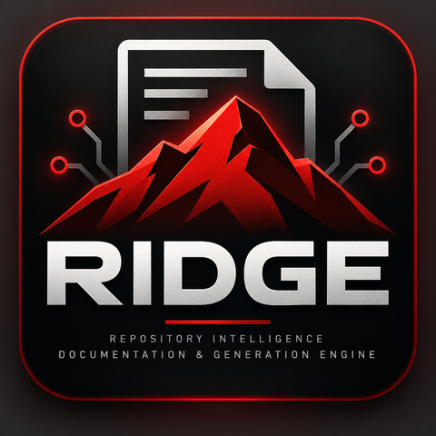

<p align="center">
  
</p>

## RIDGE — Repository Intelligence Documentation & Generation Engine

Every project leaves a trail: commits, notes, decisions made and reversed. The reasoning behind the work lives in that trail, and it is normally lost — commits record what changed, not why.

RIDGE reads that trail and turns it into a record worth keeping. It runs weekly, reads authored markdown and git metadata from a project's archive, and drafts a field note describing what happened and why. Facts are assembled deterministically; only the prose is written by a model. Every claim traces back to a source record.

Output is a pull request. A human reviews and merges. RIDGE does not publish, does not author plans, and does not modify the records it reads.

Runs locally on open tooling. Model-agnostic by configuration. Built to be reused across projects.

### Why this exists

This project is also how I'm teaching myself to build an agent — from the ground up, using a real need instead of a toy example. That's the actual goal; RIDGE supporting [redmountainindustries.com](https://www.redmountainindustries.com) is the real need that keeps the learning grounded instead of abstract.

### Status

RIDGE is built one phase at a time (Define, Design, Boundaries, Decide, Plan, Build, Integrate, Operate), and each phase closes with a written decision before the next one starts. Define, Design, Boundaries, Decide, and Plan are closed. Build is underway.

Right now RIDGE can check its own setup, and run its pipeline for every project listed in its config. For each project, it finds that project's marker file and reads every record in the folders the marker lists. It works out what type each record is (a session, a decision, a milestone) and checks that it has the fields that type needs. A record that fails the check is skipped, and RIDGE prints which file and why. Two records that share the same id are also flagged. It also reads that project's git history for a configured lookback window and reports how many commits it found. RIDGE doesn't write anything back out yet.

See it running for real, with real output, against a small public sample archive: [ridge-agent-demo](https://github.com/MarkMonterosso/ridge-agent-demo).

Weekly progress is written up by hand until RIDGE can write it itself: [redmountainindustries.com/projects/ridge](https://www.redmountainindustries.com/projects/ridge)

### Requirements

- Python 3.11+
- [LM Studio](https://lmstudio.ai/) running locally, serving a local model over its OpenAI-compatible API
- A GPU with roughly 16GB+ VRAM, enough to run a ~26B parameter model locally at a reasonable quantization

## Using RIDGE

### 1. Install it

```
pip install -r requirements.txt
```

### 2. Get the demo project

RIDGE needs a project to read. Start with the public demo,
[ridge-agent-demo](https://github.com/MarkMonterosso/ridge-agent-demo).
Clone it into the same parent folder as `ridge-agent`, so the two
sit side by side:

```
your-folder/
  ridge-agent/
  ridge-agent-demo/
```

### 3. Make your config file

Copy `config.example.yml` to `config.yml`. The example already
points at the demo, so you don't need to change anything yet.
`config.yml` is gitignored, because it holds paths for your own
machine.

If you skip this step, RIDGE stops with `File not found: config.yml`.

### 4. Check your setup

```
py main.py --check
```

This checks your setup without running anything else. For each
project in `config.yml` it checks that:

- the project folder exists and has a `ridge.yml`
- `ridge.yml` has an `id`
- `git_repo` is either left out, or points at a real git repo
- each folder listed under `conventions` exists

It also lists every record file RIDGE would skip, and why. Each line
is tagged:

- `[ERR]` RIDGE can't run until you fix this
- `[WRN]` RIDGE will run, but take a look
- `[INF]` just so you know

On the demo you'll see two `[WRN]` lines. Those are two sample files
that are broken on purpose. The check ends with "Setup looks good"
when there are no `[ERR]` lines. If there are any, it exits with
code 1, so a script can tell the check didn't pass.

### 5. Run it

```
py main.py
```

To use a config file somewhere else:

```
py main.py --config path/to/other_config.yml
```

Right now RIDGE prints a short summary for each project: how many
git commits it found in the lookback window, how many valid records
it found, and any duplicate ids. It doesn't write a field note yet.

### 6. Point it at your own project

Once the demo works, edit `project_path` in your `config.yml` to
point at your own project folder, then run `py main.py --check`
again:

```yaml
projects:
  - project_path: ../path-to-your-project
    data_collection_range:
      weeks: 1
```

- `project_path` is the project's folder. RIDGE looks for a
  `ridge.yml` file at the top of it. A relative path like
  `../my-project` starts from the folder `config.yml` is in.
- `data_collection_range` says how far back to look for git
  activity. RIDGE hands it straight to Python's `timedelta`, so you
  can use `weeks`, `days`, `hours`, and so on.
- List as many projects as you like. RIDGE runs the same steps for
  each one.

Your project folder needs a `ridge.yml` at its top level. To make
one, copy `ridge.example.yml` from this repo into your project
folder, rename it `ridge.yml`, and change the values. Every option
is explained in comments inside that file. The main ones:

- `id` names the project and never changes, even if you rename the
  folder.
- `included_patterns` lists the file names RIDGE may read, written as
  file name patterns with wildcards. `"*.md"` means every file ending
  in `.md`. Anything that doesn't match is ignored, and leaving the
  line out reads only markdown files. RIDGE only looks inside
  subfolders when a pattern starts with `**/`, so `"**/*.md"` reads
  `.md` files in each folder and every folder inside it. You can list
  more than one pattern.
- `conventions` says which folder holds which kind of record. Name
  your folders whatever you want. If a record file has no `type:`
  line, RIDGE uses the type of the folder it's in.

Then run `py main.py --check` to confirm RIDGE can read it.

## Developing RIDGE

### Install the development tools

```
pip install -r requirements-dev.txt
```

This installs everything in `requirements.txt`, plus `pytest` and
`ruff`.

### Run the tests

The tests read `config.example.yml` and follow it to the demo
project, the same way RIDGE follows `config.yml` on a real run. So
you need `ridge-agent-demo` cloned next to `ridge-agent` (step 2
above) before the tests will run. Leave `config.example.yml` pointed
at the demo when you commit it.

From the `ridge-agent` folder:

```
pytest
```

To run only some tests, use `-k` with part of their name:

```
pytest tests/test_records.py -k milestone
```

Some tests check the demo's sample files by id, so if you change a
demo file, expect a test to notice.

### Check code style

```
ruff format .
ruff check .
```

### Project structure

| File | What it does |
| --- | --- |
| `main.py` | Entry point. Parses command-line arguments and runs the pipeline in order. |
| `config.py` | Reads `config.yml` and a tracked project's `ridge.yml` marker file. |
| `records.py` | Reads the records in a project's folders, works out each one's type, checks it, and flags duplicate ids. |
| `setup_check.py` | Checks the setup without running RIDGE. This is what `py main.py --check` runs. |
| `file_io.py` | Shared file-reading helper, used by `config.py` and `records.py`, that always reads as UTF-8. |
| `git_history.py` | Reads recent commit history from a project's code repo. |
| `tests/` | The test suite. One file per module above (`test_config.py`, `test_file_io.py`, `test_records.py`, `test_git_history.py`, `test_setup_check.py`). |
| `conftest.py` | Empty on purpose. Because it's here, pytest treats this folder as the project root, so the tests can import the modules above. |
| `pytest.ini` | Test settings: one line per test, short failure messages. |
| `config.example.yml` | Template for `config.yml`. Points at the demo project. |
| `ridge.example.yml` | Template for a project's `ridge.yml`, with every option explained. |

### Logging conventions

RIDGE tags its own console output so you can tell what matters at a glance:

- `[INF]` just so you know, nothing is wrong (for example, no commits found in the window)
- `[WRN]` RIDGE will keep going, but take a look
- `[ERR]` something is broken and needs fixing

A real misconfiguration (a bad `git_repo` path, a missing `config.yml`) exits the program outright rather than logging `[ERR]` and continuing.

### License

MIT, see [LICENSE](LICENSE).
